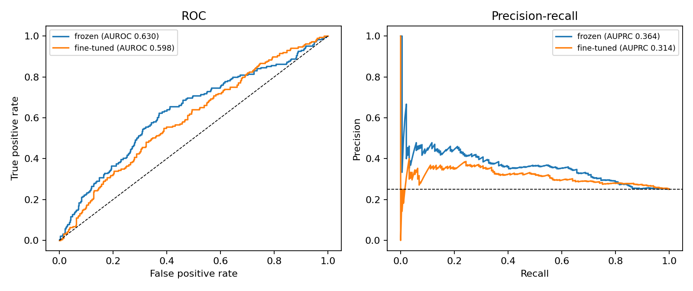
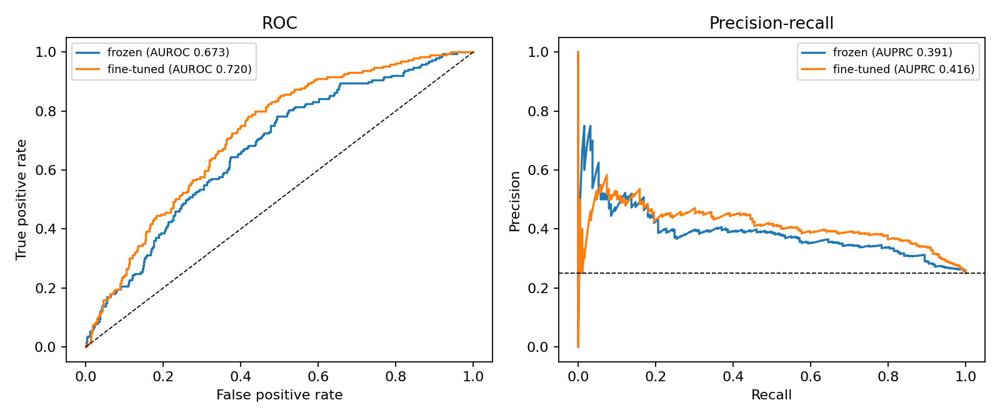
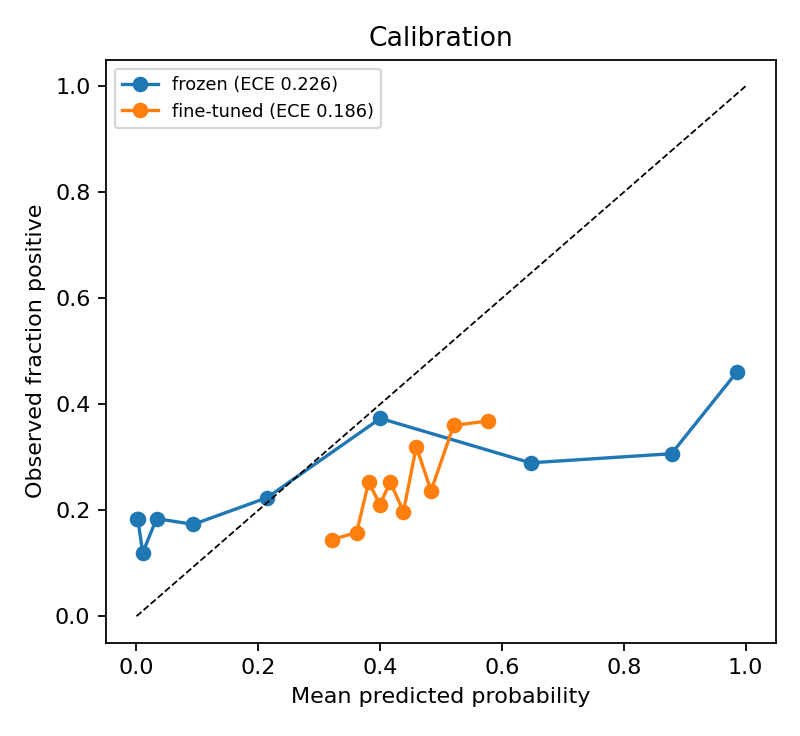
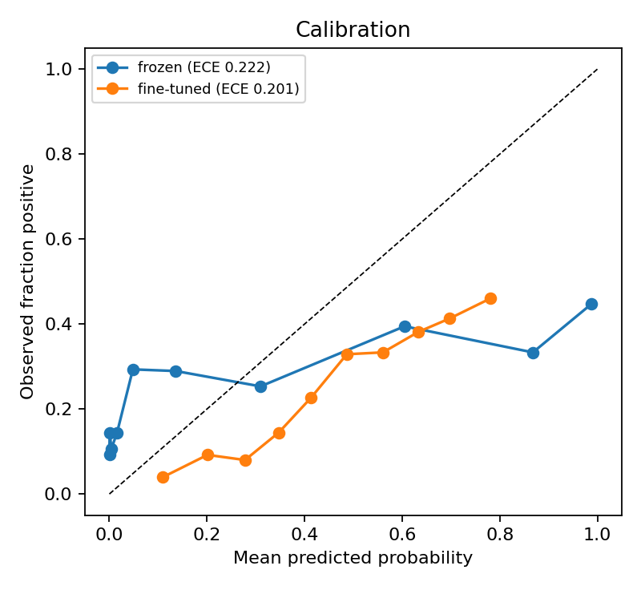

# Does a protein language model encode AD/PD co-dysregulation?

A sequence-only test of whether ESM-2 representations separate the 189 proteins
found concordantly dysregulated in Alzheimer's and Parkinson's disease brain
(ROSMAP, n = 125) from background human proteins.

The point of the experiment is the evaluation, not the accuracy. A protein
language model sees only amino acid sequence, and disease dysregulation is a
property of cellular context rather than of sequence, so the honest prior is
that this should work poorly. What the experiment establishes is how poorly,
with calibrated uncertainty, against a null control.

## Result

Same 189 positives, same model and CV, two different negative sets
(n = 756, prevalence 0.25, `esm2_t12_35M_UR50D`, 5-fold stratified CV, pooled
out-of-fold predictions, 2000-sample bootstrap CI).

| negatives | model | AUROC (95% CI) | AUPRC | Brier | ECE |
|---|---|---|---|---|---|
| reviewed human proteome | frozen + logistic regression | 0.673 (0.631, 0.712) | 0.391 | 0.251 | 0.222 |
| reviewed human proteome | fine-tuned, top 2 layers | 0.720 (0.681, 0.757) | 0.416 | 0.212 | 0.201 |
| reviewed human proteome | label-permutation control | 0.505 | 0.265 | 0.338 | 0.331 |
| **quantified in ROSMAP, not concordant** | frozen + logistic regression | **0.630 (0.584, 0.677)** | 0.364 | 0.260 | 0.226 |
| **quantified in ROSMAP, not concordant** | fine-tuned, top 2 layers | **0.598 (0.549, 0.643)** | 0.314 | 0.218 | 0.186 |
| **quantified in ROSMAP, not concordant** | label-permutation control | 0.479 | 0.239 | 0.342 | 0.318 |

The ROSMAP background is the run that tests the question in the title. The
proteome background is kept for comparison.

| ROSMAP background | Proteome background |
|---|---|
|  |  |
|  |  |

**What changed when the background changed.**

1. **Most of the original signal was detectability, not disease.** Against
   proteins that ROSMAP also quantified, AUROC fell from 0.720 to 0.598
   (fine-tuned) and from 0.673 to 0.630 (frozen). The same pattern is visible
   inside the first run: scoring its predictions against only the 225 negatives
   that ROSMAP quantified gives AUROC 0.57 for both models, against 0.74
   (frozen) and 0.82 (fine-tuned) for the 342 negatives it did not. The first
   classifier was largely separating brain-detectable proteins from the rest of
   the proteome.
2. **Fine-tuning stopped helping.** On the proteome background, fine-tuning
   beat the frozen model by 0.047 AUROC (paired bootstrap 95% CI 0.003 to
   0.097). On the ROSMAP background the difference is −0.032 (CI −0.098 to
   0.024). The extra capacity was spent learning the confound.
3. **A small residual signal remains.** Both ROSMAP-background CIs exclude
   0.5, and the permutation control sits at 0.479. A plausible source is
   abundance rather than disease biology: more abundant proteins are
   measured more precisely and so reach significance in both diseases more
   easily, and abundance correlates with sequence composition. This run cannot
   separate the two.
4. **Calibration is poor throughout.** ECE near 0.2 in every run means the
   rankings carry some information and the predicted probabilities should not
   be read as confidence.

**Bottom line.** Sequence alone carries little information about which brain
proteins are concordantly dysregulated in AD and PD once detectability is
controlled. That is the expected answer, and the drop from 0.72 is the main
finding: the choice of background decided most of the headline number.

## Design

| | |
|---|---|
| Positives | 189 unique UniProt entries from the concordant AD/PD protein set (190 symbols submitted, 0 unmatched) |
| Negatives | length-matched 3:1 sample of either the reviewed human proteome or the proteins quantified in ROSMAP but not concordant (pool of 8,031 matched UniProt entries) |
| Representation | mean-pooled final-layer ESM-2 (`facebook/esm2_t12_35M_UR50D`) |
| Models | L2 logistic regression on frozen embeddings; ESM-2 with top 2 encoder layers unfrozen |
| Validation | 5-fold stratified CV, pooled out-of-fold predictions |
| Discrimination | AUROC, AUPRC, with 2000-sample bootstrap 95% CI over proteins |
| Calibration | Brier score, 15-bin expected calibration error |
| Null control | label permutation, expected AUROC near 0.500 |

Sequence length is the strongest confounder available to a sequence-only
classifier, so the background is length-matched by decile rather than sampled
uniformly. Class imbalance is handled in the loss, not by resampling.

With 189 positives and 567 negatives the null AUROC has a standard deviation
of about 0.024 (Mann-Whitney), so an AUROC below about 0.55 is not
distinguishable from chance at n = 756. Only one permutation is run, so this
is the analytic value, not an empirical null distribution.

## Run it

```bash
python -m venv .venv && source .venv/bin/activate
pip install -r requirements.txt
python run_experiment.py                # ~20-40 min on an M-series Mac
python run_experiment.py --quick        # ~5 min, 8M model, 3 folds, smoke test
```

The first run downloads the reviewed human proteome from UniProt (about 15 MB)
and caches it as `uniprot_human_reviewed.tsv`, which is not tracked here.

### Reproducing both results

`background_rosmap_quantified.txt` holds the 8,059 gene symbols quantified in
the same ROSMAP proteomics run that are not in the concordant set (8,031
resolve to UniProt entries distinct from the positives). Using it as the
negative pool removes the "detectable brain protein" confound. It does not
remove differences in abundance or measurement precision between proteins.

```bash
# proteome background (results/proteome_background)
python run_experiment.py --outdir results/proteome_background

# ROSMAP background, length-matched 3:1 subsample (results/rosmap_background)
python run_experiment.py --background background_rosmap_quantified.txt \
    --outdir results/rosmap_background

# every non-concordant protein as a negative, prevalence 0.023 (not yet run)
python run_experiment.py --background background_rosmap_quantified.txt \
    --use-all-background --skip-finetune --outdir results/rosmap_all
```

One gene symbol per line. Any symbol UniProt cannot resolve is written to
`unmatched_genes.txt` and reported rather than silently dropped.

## Outputs

Each run writes to `--outdir` (default: the current directory):

- `results.json`: metrics, CIs, config, and run metadata
- `predictions.csv`: per-protein out-of-fold probabilities
- `figures/roc_pr.png`, `figures/calibration.png`
